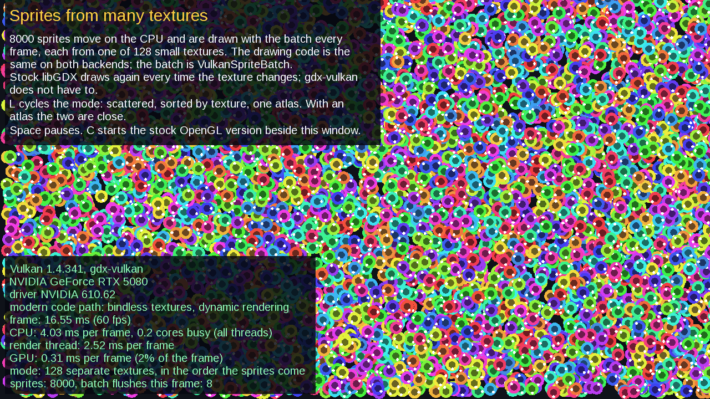
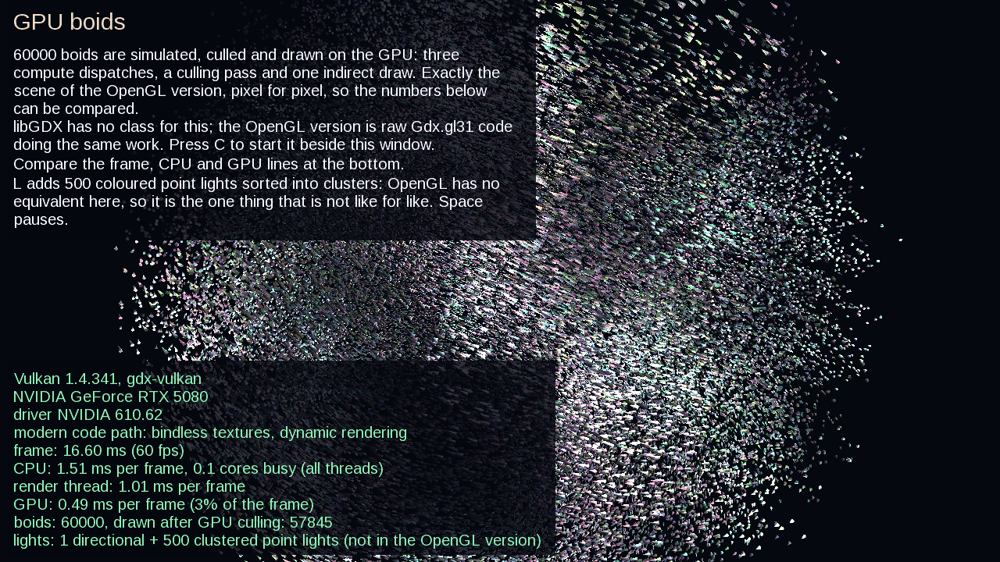
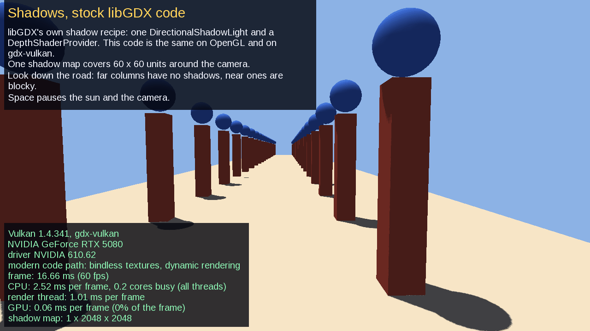
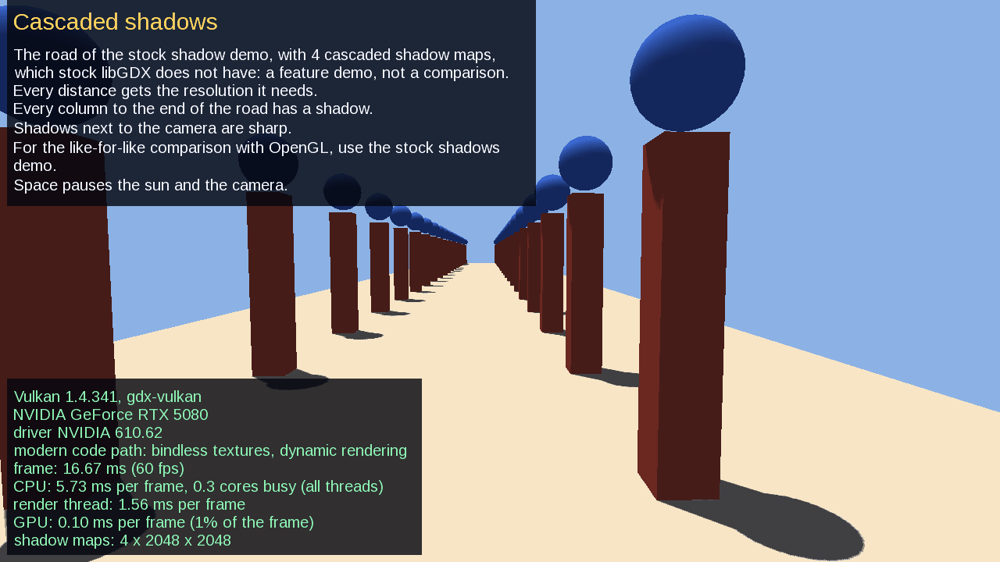

# gdx-vulkan

A Vulkan renderer for [libGDX](https://libgdx.com). It draws with Vulkan instead of OpenGL, on **unmodified libGDX** (1.14.2): no fork, no patched jars.
Your `Texture`, `Pixmap`, `FrameBuffer`, `BitmapFont`, Scene2D `Stage`, `ModelBatch` code and the rest of the libGDX API keep working; you swap the
renderer underneath them.

## Why

- **Speed where OpenGL is slow.** Switching textures is cheap in Vulkan. A scene drawn from many separate textures runs 17 to 24 times faster than stock libGDX
  on the same machine, on a desktop card and on both phones we test with (see [Performance](#performance)). A game that already packs its art into atlases gains little:
  about the same speed on a desktop card, and on phones between 0.8x and 1.3x depending on the GPU.
- **The GPU can do work OpenGL could not give you, and do it with less CPU.** Compute shaders, indirect draws and GPU-side culling are available from libGDX: one million sprites
  moved by a compute shader at 722 frames per second on a 2018 graphics card; 250,000 lit 3D meshes at 495. Against stock libGDX doing the same boid simulation with OpenGL compute shaders,
  250,000 boids run 2x faster on an RTX 5080 at a fifth of the CPU.
- **No fork to maintain.** gdx-vulkan implements libGDX's own `GL20` interface on top of Vulkan, so the stock classes run as they are. When libGDX is updated,
  you update libGDX.
- **Android that survives the lifecycle.** The Vulkan surface can be destroyed and recreated (rotation, background, foreground) without reloading a single
  texture: recreation takes about 2 ms on the phone we test with. There is no "managed texture" reload.

### What to expect

Measured against stock libGDX on the same machines (details and the cases gdx-vulkan does not win in [Demo measurements](#demo-measurements)):

- **Big wins:** many separate textures (18 to 47x), sprites sorted by texture (1.4 to 2x on the desktop card and the REDMAGIC), and GPU-driven rendering (compute, culling, indirect draws: 2x at 250,000 boids on the
  desktop at under a third of the CPU, 3.7x at 60,000 boids on the REDMAGIC).
- **About equal:** a texture atlas (1.0x to 1.15x on the desktop card and the S20, 0.81x on the REDMAGIC) and a small GPU-driven scene (10,000 boids on a phone).
- **Slower:** libGDX's own classes run unchanged through the GL shim at 0.6 to 0.8x of OpenGL's speed on the desktop and the REDMAGIC, with about the same CPU. The `Vulkan...` classes are the fast path.
- **Power:** one measurement on the REDMAGIC, 10,000 boids at 60 fps: gdx-vulkan used about 6% more battery power than OpenGL ES. Do not expect Vulkan to save energy by itself.

## Status

Beta. Everything below is built and tested against stock libGDX on OpenGL, with the Vulkan validation layers on.

| Works today | |
|---|---|
| 2D | `SpriteBatch`, `PolygonSpriteBatch`, `ShapeRenderer`, `BitmapFont`, Scene2D, `TextureAtlas`, particles, compressed textures (ETC2, ASTC, ...), custom shaders (libGDX GLSL, or SPIR-V) |
| Framebuffers | the stock `FrameBuffer` (colour, depth, stencil), multiple and floating-point colour attachments |
| 3D | `ModelBatch` with `ModelInstance`, `Environment`, directional and point lights, textures, normal maps, fog, skeletal animation, blending, shadow maps (one, or cascaded), instancing; models from `G3dModelLoader` or `ModelBuilder` |
| GPU-driven | compute shaders, GPU culling, indirect drawing, clustered lighting for hundreds of lights |
| Stock classes, unchanged | libGDX's own `SpriteBatch`, `PolygonSpriteBatch`, `ShapeRenderer`, `Stage`, `ModelBatch` (`DefaultShader`, `DepthShader`) and your own `ShaderProgram`s run as they are, through the GL shim. The `Vulkan...` classes do the same work written straight against Vulkan and are the fast path |
| Shaders | libGDX's GLSL (`attribute`, `varying`, `uniform`, `gl_FragColor`) is translated to Vulkan at run time and cached on disk; libGDX's own sprite, shape and model shaders are compiled when the library is built, so they cost no start-up compile; SPIR-V bundles are accepted too |
| Demos | `gdx-vulkan-demos`: a demo app with a menu, with stock OpenGL versions to start beside it on the desktop; the same app on Android (`gdx-vulkan-android/demoapp`, with a stock OpenGL ES activity to measure against); see [Demos](#demos) |
| Platforms | Windows x64, Linux x64 (X11), Android 10+ (arm64) |
| Application | a desktop `Application` (`VulkanDesktopApplication`) and an Android one (`VulkanAndroidApplication`), with stock input, audio and files |

| Not yet | |
|---|---|
| macOS and iOS | needs a Mac to build and test; not started |
| Wayland | X11 only on Linux |
| Some GLSL | cube maps and 3D samplers, structs with array or matrix members, `bool` arrays, array varyings, and (on a Vulkan 1.1 driver) more than one texture per draw are refused with a message that names the line |
| More of OpenGL | the shim covers what libGDX's classes use: programs, uniforms, one vertex buffer (or vertex data in memory) and array or indexed draws. `Gdx.gl30` and `gl31` stay null, so instancing, several vertex buffers, vertex formats other than floats and normalised bytes, query objects and compute through GL are not available; use the Vulkan classes (`VulkanComputeShader`, `VulkanGpuInstances`) |
| Spot lights, point-light shadows in `VulkanModelBatch` | libGDX's own default shader has no spot light code (on OpenGL a spot light changes nothing; `gate5_spot` checks that the shim agrees), so there is none to port. Point lights work; point-light shadows are not built |
| Maven Central | not published yet; see [Getting it](#getting-it) |

The item-by-item list, including what is partial and why, is in [`docs/CHECKLIST.md`](docs/CHECKLIST.md) (205 of 249 items done).

**Tested on** an NVIDIA RTX 5080 and RTX 2080 (Windows), a software Vulkan driver (lavapipe, on Linux, in CI on every commit), a REDMAGIC phone with an
Adreno 840 (Android 16) and a Samsung Galaxy S20 FE 5G with an Adreno 650 (Android 13). Both phones pass the whole device suite (32 checks, 3D included, both code paths on the REDMAGIC), and the demos run on both; what each GPU needed is in [`docs/DRIVER_NOTES.md`](docs/DRIVER_NOTES.md). Other GPUs and drivers should work but have not been tried.

## Performance

Every number below was measured with this repository's benchmark programs (commands in [`docs/TESTING.md`](docs/TESTING.md)), against stock libGDX 1.14.2 on
OpenGL where a stock equivalent exists, on the same machine with the same sprites and vsync off. Results are in frames per second (higher is better) unless the
table says otherwise. More devices will be added over time: see [Adding a device](#adding-a-device).

### Devices

| ID | Device | OS | GPU | CPU | Vulkan version of the driver | Which code path it runs |
|---|---|---|---|---|---|---|
| PC-5080 | Desktop PC | Windows 10 Pro 22H2 | NVIDIA GeForce RTX 5080 (driver 610.62) | Intel Core i7-6900K, 128 GB RAM | 1.4 (1.4.341) | modern (forced to the compatibility path for one row) |
| PC-2080 | the same desktop PC | Windows 10 Pro 22H2 | NVIDIA GeForce RTX 2080 (driver 610.62) | Intel Core i7-6900K, 128 GB RAM | 1.4 (1.4.341) | modern |
| RM-11P | REDMAGIC Pro 11 (NX809J), display set to 144 Hz; tested over wireless debugging | Android 16 | Qualcomm Adreno 840 | Qualcomm Snapdragon (model not recorded) | 1.4 | modern, and compatibility when forced |
| S20-FE | Samsung Galaxy S20 FE 5G (SM-G781W), display set to 120 Hz | Android 13 | Qualcomm Adreno 650 | Snapdragon 865 (SM8250) | 1.1 (1.1.128) | compatibility only |
| CI | GitHub Actions runner | Ubuntu 24.04 | lavapipe (software, Mesa 25.2) | | 1.3 or newer | modern and compatibility; used for correctness, not speed |

The modern path needs a Vulkan 1.3 driver; the compatibility path needs Vulkan 1.1 and is slower with many textures. The library picks the best one the device
supports. Stock OpenGL runs on the display GPU, so on the two-GPU PC only PC-5080 has a fair stock comparison.

### The tests

| ID | What it draws | What it measures |
|---|---|---|
| T1 | 20,000 sprites per frame, all from **one texture** (what a texture atlas gives you), 800x600 on the PC and full screen on a phone | the normal case for a 2D game: `SpriteBatch` against `VulkanSpriteBatch` |
| T2 | the same 20,000 sprites, each taken from one of **128 separate textures** (no atlas) | the worst case for OpenGL: every sprite changes texture |
| T3 | **1,000,000 sprites** moved every frame by a compute shader | how much the GPU can do on its own; stock libGDX cannot run it |
| T4 | **250,000 lit 3D meshes** moved by a compute shader, culled on the GPU and drawn with one indirect call, with **500 point lights**, 1280x720 on the PC and full screen on a phone | the GPU-driven path; stock libGDX cannot run it |
| T5 | T4 at a mobile load: 50,000 meshes and 64 lights | the same on phone-sized work |
| T6 | T1 drawn with a shader **translated at run time** (`VulkanShaderProgram`), against the batch's built-in shader. Until 2026-11-04 the translated shader was libGDX's own sprite shader; since libGDX's own shaders are now recognised and replaced by the dedicated ones, the "translated stock shader" rows below that predate it are historical and the custom shader is the live measurement | what a game's own shader costs compared with a built-in one |
| T7 | T1 drawn by **libGDX's own `SpriteBatch`, unmodified, through the GL shim**, against `VulkanSpriteBatch` (`gradlew :gdx-vulkan-desktop:stressShim`) | what running stock code unchanged costs compared with the renamed classes |

### Results

Higher is better. "Stock" is libGDX 1.14.2 on OpenGL; a dash means the test has no stock equivalent, and *not run* means it has not been measured on that device yet.

| Test | Device | Stock libGDX (OpenGL) | gdx-vulkan | Difference |
|---|---|---|---|---|
| T1 one texture | PC-5080 | 1,064 fps | 1,306 fps | 1.2x |
| T1 one texture | RM-11P (144 Hz, vsync off) | not run | 1,402 fps (modern, steady state; it was 548 before a shader fix, see below), 1,428 fps (compatibility, earlier run) | |
| T1 one texture | S20-FE (120 Hz, vsync off) | not run | 717 fps | |
| T2 128 textures | PC-5080 | 17.5 fps | 423 fps (modern), 61-70 fps (compatibility) | **24x**, 3.5-4x |
| T2 128 textures | RM-11P | not run | 38 fps (modern), 8.6 fps (compatibility) | |
| T2 128 textures | S20-FE (120 Hz, vsync off) | not run | 11.6 fps (compatibility) | |
| T3 1M sprites by compute | PC-5080 | - | 1,879 fps | |
| T3 1M sprites by compute | PC-2080 | - | 722 fps | |
| T3 1M sprites by compute | RM-11P | - | 208-225 fps | |
| T4 250,000 meshes, 500 lights | PC-5080 | - | 957-988 fps | |
| T4 250,000 meshes, 500 lights | PC-2080 | - | 495 fps (1% low: 259) | |
| T4 250,000 meshes, 500 lights | RM-11P | - | 52 fps | |
| T4 250,000 meshes, 500 lights | S20-FE | - | 7.5 fps | |
| T3 1M sprites by compute | S20-FE | - | 69 fps | |
| T5 50,000 meshes, 64 lights | RM-11P | - | 781 fps | |
| T5 50,000 meshes, 64 lights | S20-FE | - | 72 fps | |
| T6 translated stock sprite shader | PC-5080 | built-in shader 1,332 fps (modern path), 1,323 fps (compatibility) | 1,319 fps (modern), 1,288 fps (compatibility) | 0.99x, 0.97x |
| T6 translated stock sprite shader | PC-2080 | built-in shader 1,275 fps | 1,273 fps | 1.00x |
| T6 translated stock sprite shader | RM-11P (144 Hz, vsync off) | built-in shader 1,545 fps | 1,457 fps | 0.94x (rounds 1 to 3 within 2% of each other; round 4 was noisy) |
| T6 translated stock sprite shader | S20-FE (120 Hz, vsync off) | built-in shader 721 fps (cool), 518 fps (throttled) | 713 fps (cool), 511 fps (throttled) | 0.99x in either state |
| T6 translated custom shader (push-constant tint, uniform-block palette), re-run 2026-11-04 | RM-11P (144 Hz, vsync off) | built-in shader, rounds 3 and 4 (one clock state): 1,244 and 1,243 fps | 1,239 and 1,233 fps (modern); 0.94x on average over four rounds on the compatibility path | 1.00x within a clock state |
| T7 stock `SpriteBatch` on the shim, one texture | PC-5080 | - | 928 fps (modern), 879 fps (compatibility) against 1,227 fps for `VulkanSpriteBatch` | 0.76x, 0.72x |
| T7 stock `SpriteBatch` on the shim, one texture | PC-2080 | - | 1,205 fps against 1,256 fps | 0.96x |
| T7 stock `SpriteBatch` on the shim, one texture | S20-FE (120 Hz, vsync off) | - | 499 fps against 563 fps | 0.89x |
| T7 stock `SpriteBatch` on the shim, one texture | RM-11P (144 Hz, vsync off) | - | 1,092 fps (modern), 1,098 fps (compatibility) against 1,236 and 1,230 fps | 0.88x, 0.89x |
| T7 stock `SpriteBatch` on the shim, eight textures | PC-5080, PC-2080 | - | 1.23x and 1.28x of `VulkanSpriteBatch` (modern), 0.78x (PC-5080 compatibility) | the stock batch flushes at each texture change; on a desktop GPU that is not always slower |

Two more results that are not about a single device:
- **Java layer:** recording 100,000 draws through the Java API costs 1.0 to 1.3 times a hand-written C++ loop on both PCs and the phones, and the 3D benchmark
  allocates about 1 byte of Java garbage per frame.
- **Android lifecycle (RM-11P):** 50 rotate and background/foreground cycles with textures streaming in and out: 0 failures, the surface comes back in 2 ms on
  average (5 ms worst), memory flat. On S20-FE: 8 cycles, 0 failures, 13 ms.

How to read these:
- T2 gives every sprite a random one of 128 textures, so neighbouring sprites always differ: the worst case, and the reason it is slow on phones (a divergent texture lookup per quad on the modern path, 20,000 draws a frame on the compatibility path). A game that draws layer by layer, or packs atlases, is far from it.
- T2 is the case Vulkan helps most. A game that packs its art into atlases is closer to T1, about 1.2x. The renderer started out slower than stock on T1
  (0.91x) until vertex data got a copy in GPU memory.
- Stock OpenGL cannot run T3 to T5, so there is nothing to compare; they show what the extra control buys.
- Phones need about six seconds to settle (the JIT compiles the draw path, the GPU clock rises), and a phone can step between two clock speeds during a long run.
  The phone numbers are measured after a six-second warm-up, and the shader comparison alternates the order of the shaders and is read inside one clock state.
- The RM-11P one-texture number was 548 fps until a shader was fixed: the sprite batch's single-texture shader got its texture slot through a varying, which the
  Adreno compiler could not tell was the same for every pixel, so it took its slow path for indexing the bindless texture table. Reading the slot from the push
  constants in the fragment shader made it 2.6 times faster on that phone. The desktop GPUs were not affected (that test is CPU-bound there).
- The phone stepped from about 2,000 fps to about 1,240 fps between rounds 2 and 3 of the T6 run (a clock or thermal state), which is why the comparison is read inside one state.
- T7 is the cost of not renaming: libGDX's own batch, with the shader replaced by the dedicated one, runs at about three quarters of the speed of `VulkanSpriteBatch` on the RTX 5080 (a CPU-bound test: the shim records one draw per flush, the generated batch writes straight into GPU-visible memory) and at 0.9x to 1.0x on the RTX 2080 and the phone.
- The whole device suite was re-run on RM-11P on 2026-11-04 on the current code (32 checks, both code paths, all passed, no validation messages: the layers are not on the device): T1 1,462 fps (modern) and 1,230 (compatibility), T2 37.3 and 10.4 fps, T3 208 fps on both, T4 48.5 and 47.9 fps, T5 791 and 733 fps; GPU time per frame (timestamp queries) for the T7 sprites 0.62 ms (`VulkanSpriteBatch`) and 0.69 ms (stock `SpriteBatch` on the shim).
- The S20-FE was re-run on 2026-11-04 on the current code (32 checks, all passed, 3D included): T1 517 fps (the phone was in a lower clock state than for the 717 above), T2 10.9 fps, T3 69 fps, T4 7.5 fps, T5 72 fps.
- The phones' stock OpenGL ES numbers are in [Demo measurements](#demo-measurements) (the same scenes on stock libGDX and on gdx-vulkan); the T-rows above have no stock number on a phone because the benchmark programs for them run on the desktop.

Rendering matches stock libGDX: the test scenes are drawn by stock OpenGL and by gdx-vulkan and compared pixel by pixel. The framebuffer scenes are identical;
the 2D and 3D scenes differ in at most 0.2% of pixels, at the ends of lines and edges.

### Demo measurements

The demos run the **same scene on both backends** and show the same numbers on screen (frame time, CPU per frame over all threads, CPU of the render thread, GPU time). The
scenes match pixel for pixel where a comparison is claimed (the boids' shaders do the same arithmetic on both; the sprite demo is the same `Batch` code with one line changed).
Reproduce them with `tools/compare-demos.sh <sprites|boids|shadows>` (desktop) and `tools/compare-phone.sh <serial> <sprites|boids|shadows>` (phone). Frames per second, vsync off,
stock libGDX on OpenGL / OpenGL ES first and gdx-vulkan second in every cell. `HUD=false` in the environment (`-Ddemo.hud=false`) leaves the on-screen text off, so that the first table measures the scene.
The numbers were taken on 2026-11-04 after the batch fix described below; the REDMAGIC was charging during them (it was on battery for the energy runs).

**The scene alone** (no text on screen):

| Scene | RTX 5080 | Galaxy S20 FE (Adreno 650, Tier B) | REDMAGIC (Adreno 840, Tier A) |
|---|---|---|---|
| Sprites, 128 textures, scattered | 21 / **380** | 1.1 / **23** | 4 / **180** |
| Sprites, sorted by texture | 793 / **1,111** | 349 / 382 | 470 / **952** |
| Sprites, one atlas | 1,171 / 1,253 | 441 / 505 | 1,217 / 985 |
| Boids (250,000 on the desktop, 10,000 on the phones) | 489 / **983** | 142 / 541 (see below) | 1,731 / 1,952 |
| Boids, 60,000 on the phones | | 25 / 114 (see below) | 394 / **1,467** |
| Stock shadow demo through the shim | 1,832 / 1,308 | 414 / 515 | 798 / 508 |

(20,000 sprites on the desktop, 10,000 on the phones.)

**As the demo app runs it, with the text on screen:**

| Scene | RTX 5080 | Galaxy S20 FE | REDMAGIC |
|---|---|---|---|
| Sprites, scattered | 18 / **416** | 1.1 / **22** | 3 / **141** |
| Sprites, sorted | 892 / 886 | 309 / 346 | 311 / **645** |
| Sprites, one atlas | 1,034 / 1,139 | 402 / 438 | 809 / 656 |
| Boids (250,000 on the desktop, 10,000 on the phones) | 487 / **859** | 451 / 469 | 1,173 / 1,177 |
| Boids, 60,000 on the phones | | 127 / 108 | 293 / **439** |
| Stock shadow demo through the shim | 1,497 / 1,177 | 406 / 376 | 632 / 439 |

CPU per frame (all threads), with the text: 250,000 boids on the RTX 5080 take 2.4 ms on OpenGL against 0.69 ms; at a fixed 60 fps 3.7 ms against 2.5 ms of CPU. The many-texture sprites take 72 ms against 2.4 ms.

**Energy** (REDMAGIC on battery, display at 60 Hz, vsync on, text on, 10,000 boids, mean battery power over a minute with the screen on, `tools/energy-phone.sh`): OpenGL ES 1,606, 1,584 and
1,536 mW (three runs), gdx-vulkan 1,667 and 1,667 mW (two runs; a third was lost when the phone was plugged in). So gdx-vulkan used about 6% **more** power than stock OpenGL ES for this scene at the same
frame rate, in step with its higher CPU time per frame (3.0 against 2.4 ms over all threads). The sprite and shadow scenes were not measured: the phone started charging. On the desktop card the power at 60 fps was the
same on both backends within noise (about 27 W).

What the numbers say:

- **Many textures is the case where gdx-vulkan wins big**: 18 to 47x on the three machines, with no change to the drawing code.
- **Sorting sprites by texture is now a win on the desktop card and the REDMAGIC** (1.4x and 2.0x without text; with the text on screen the desktop is level and the REDMAGIC 2.1x). It was a loss (0.76x, 0.2 to 0.3x) until the batch drew one call per run of
  sprites that share a texture, with the texture index taken from the push constants, instead of passing it through the vertices: the Adreno compiler is slow on an index that arrives through a varying
  (`docs/DRIVER_NOTES.md`).
- **GPU-driven work** (compute simulation, GPU culling, one indirect draw): 2x for 250,000 boids on the desktop card at under a third of the CPU, 3.7x for 60,000 boids on the REDMAGIC without text, 1.5x with it. At
  10,000 boids the REDMAGIC is level with OpenGL ES.
- **One atlas is not a win**: equal or 15% better on the desktop and the S20, 0.81x on the REDMAGIC (0.8 ms of GPU time for 10,000 sprites against 0.47 ms on OpenGL ES; the cause is open).
- **On-screen text** costs gdx-vulkan 0.4 ms against 0.2 ms per frame on the REDMAGIC now (it was 1.7 ms: the text uses two fonts, and the batch wrote every vertex of a mixed-texture draw through a
  `ByteBuffer`, which is slow on ART). It is still about twice OpenGL's cost.
- **The Galaxy S20's OpenGL ES boids depend on a 2D draw following the scene**: without any draw after the scene they run at 142 fps, with the text or even just two filled rectangles at 529 (a tile-based driver
  behaviour; the GL demo's `glMapBufferRange` of the visible count is not the cause, the layout-only runs stay at 145). gdx-vulkan's speed does not change (541 and 469). The fair rows are the ones with the text
  on screen, where the two are equal.
- **Stock code through the shim is slower than OpenGL** (0.6 to 0.8x on the desktop and the REDMAGIC, 0.93 to 1.25x on the S20) and uses about the same CPU. The shim is for porting without changing code; the gains
  come with the `Vulkan...` classes.
- **GPU times** on the phones are measured differently (timestamps across the whole frame for gdx-vulkan, a timer query around the demo's work for OpenGL ES), so the frame time is the figure to compare.

### Adding a device

1. Run the tests on the device (`docs/TESTING.md` has the commands for the PC and for Android) and note: the device name and model, the OS and its version, the
   GPU and its driver version, the CPU, and the Vulkan version the driver reports (the test log prints it, with the code path it used).
2. Add one row to the **Devices** table with a short ID (`PC-xxxx`, `RM-xxx`, ...).
3. Add one row per test to the **Results** table, with the device's ID. Put stock OpenGL's number next to it if the device ran the stock program too; if a test
   was not run, write *not run* rather than leaving it out.

## Getting it

gdx-vulkan is not on Maven Central yet. For now, add it to your Gradle build as a source dependency:

```
git clone https://github.com/slebed/gdx-vulkan
```
```groovy
// settings.gradle of your project
includeBuild('../gdx-vulkan')

// build.gradle of your project
dependencies {
    implementation 'io.github.slebed.gdx-vulkan:gdx-vulkan-core'
    implementation 'io.github.slebed.gdx-vulkan:gdx-vulkan-desktop'   // the desktop Application, GLFW and OpenAL (desktop only)
}
```

Building needs a C++17 compiler, CMake 3.20+ and `glslc` (see [`docs/TESTING.md`](docs/TESTING.md)); the build compiles the native library for your machine's platform and bundles it into the jar, and compiles the shaders. At run time you
need a GPU and driver with Vulkan 1.1 or newer (1.3 for the fastest path). Android uses its own Gradle build in `gdx-vulkan-android/`; see its README.

## Using it

### Desktop

The change from a stock libGDX desktop game is the application class and the batch:

```java
// Before: stock libGDX
public class MyGame extends ApplicationAdapter {
    SpriteBatch batch;
    Texture img;

    @Override public void create() {
        batch = new SpriteBatch();
        img = new Texture("badlogic.jpg");
    }

    @Override public void render() {
        ScreenUtils.clear(0, 0, 0, 1);
        batch.begin();
        batch.draw(img, 0, 0);
        batch.end();
    }
}

public static void main(String[] args) {
    new Lwjgl3Application(new MyGame(), new Lwjgl3ApplicationConfiguration());
}
```

```java
// After: gdx-vulkan
public class MyGame extends ApplicationAdapter {
    VulkanSpriteBatch batch;                                       // was SpriteBatch
    Texture img;                                                   // unchanged: the stock Texture

    @Override public void create() {
        batch = new VulkanSpriteBatch();                           // was new SpriteBatch()
        img = new Texture("badlogic.jpg");
    }

    @Override public void render() {                               // unchanged
        ScreenUtils.clear(0, 0, 0, 1);
        batch.begin();
        batch.draw(img, 0, 0);
        batch.end();
    }
}

public static void main(String[] args) {
    new VulkanDesktopApplication(new MyGame(), new Lwjgl3ApplicationConfiguration());   // was Lwjgl3Application; the configuration is unchanged
}
```

`VulkanSpriteBatch` implements the stock `Batch` interface, so anything that takes a `Batch` takes it: `BitmapFont.draw`, `ParticleEffect.draw`, `Image`, and
so on. Stock `SpriteBatch`, `PolygonSpriteBatch`, `ShapeRenderer`, `Stage`, `ModelBatch` and your own `ShaderProgram`s also run as they are, through the GL shim; the `Vulkan...` classes are the same classes written straight against Vulkan and are the fast path. Measured with 20,000 sprites from one texture, a stock `SpriteBatch` reaches about three quarters of `VulkanSpriteBatch`'s frame rate on the RTX 5080 and about the same on the RTX 2080 (`gradlew :gdx-vulkan-desktop:stressShim`). libGDX's own sprite, shape and 3D shaders are replaced by ones compiled when the library is built, so they cost no start-up compile.

A game's existing `Lwjgl3ApplicationConfiguration` is used as it is: window size and title, vsync, resizable, fullscreen, audio and preferences settings (the
OpenGL context settings are ignored). `VulkanDesktopConfiguration` holds the same settings in a class of ours, all optional.

The batches find the running application's frame through `Gdx.graphics`, so create them in `create()` or later, as you would stock ones. If you build the
Vulkan context yourself (a test, a tool), pass the frame explicitly: `new VulkanSpriteBatch(frame)`.

### Demos

`gradlew :gdx-vulkan-demos:demos` opens the demo app, a menu of demos on gdx-vulkan (keys 1 to 4 start one, Esc comes back). In a demo, **C starts the stock OpenGL version in a window beside it**, same size, so the two can be watched together. Each demo is a short class you can copy; the text on screen says what it is about and is sized from the window height.

**On a phone:** `gradlew :demoapp:assembleDebug` in `gdx-vulkan-android` builds `demoapp-debug.apk` (package `io.github.slebed.gdxvulkan.demos`), the same demo classes compiled from the desktop module's source. A tap on a button starts a demo; in a demo a tap on the left half of the screen is Space and on the right half is L, and Back returns to the menu. The boid demo defaults to 10,000 boids on a phone (`--ei boids N`). The same app has `GlDemosActivity`, which runs the sprite, boid and shadow demos on **stock libGDX and OpenGL ES** (libGDX's own `AndroidApplication`), for measuring against gdx-vulkan on the same phone: `tools/compare-phone.sh <serial> sprites|boids|shadows`. `tools/demos-test.sh <serial>` runs each demo for a while, prints the numbers it shows and saves screenshots (`--ei start N --ei logSeconds S` write them to `files/gdxvk-demos.log`). CPU time on the phone comes from `android.os.Process` (millisecond resolution; read over half a second).

| Demo | What it shows | Stock libGDX equivalent |
|---|---|---|
| 1 Sprites from many textures | thousands of moving sprites from 128 textures, with a mode that sorts them or packs one atlas (key L) | yes: the same `Batch` code on OpenGL, `new SpriteBatch()` instead of `new VulkanSpriteBatch()` |
| 2 GPU boids | boids simulated, culled and drawn on the GPU, pixel for pixel the OpenGL version's scene; key L adds 500 clustered point lights | yes: `demoGl -Ddemo=boids` does the same work with compute shaders (not lights) |
| 3 Shadows, stock libGDX code | libGDX's own shadow recipe (`DirectionalShadowLight`, `DepthShaderProvider`), the same class on both backends | yes: the same code on OpenGL |
| 4 Cascaded shadows | the same road with four cascaded shadow maps: a feature stock libGDX does not have | no |

| | |
|---|---|
|  |  |
|  |  |

(Sprites from many textures, GPU boids with the 500 point lights switched on, the stock shadow recipe, cascaded shadows; 1280 x 720 on an RTX 5080.)

`gradlew :gdx-vulkan-demos:demoGl -Ddemo=sprites` (or `boids`, `shadows-stock`) runs a demo on OpenGL alone. Options: `-Ddemo.sprites=N` and `-Ddemo.mode=0|1|2` (scattered, sorted, atlas), `-Ddemo.boids=N`, `-Ddemo.vsync=true` (off by default, so the frame rate shown is what the GPU can do), `-Ddemo.hud=false` (no text: measures the scene alone), `-Ddemo.width=` and `-Ddemo.height=`, `-Ddemo.lights=true` (the boids start with the 500 point lights, which OpenGL does not have), `-Ddemo.start=2 -Ddemo.screenshot=out.png` (saves a picture and leaves). Every demo shows the same fields on both backends: the API and its version, the device, the driver and the code path, then the frame time, the CPU time per frame (all threads of the process, the graphics driver's own included), the render thread's CPU time per frame, and the GPU time per frame. gdx-vulkan reads the GPU time from timestamp queries (`GdxVkPresenter.gpuFrameNanos()`); the OpenGL main uses a timer query (not available for OpenGL ES on the phones). The OpenGL driver's device name carries a `/PCIe/SSE2` suffix (the bus the card is on and the CPU instruction set the driver's software paths use); the Vulkan device name has none, so the OpenGL one is cut there to read the same. The results, with the cases where gdx-vulkan is not ahead, are under [Demo measurements](#demo-measurements); `docs/CHECKLIST.md` has the item list.

### Moving an existing game over

| Stock libGDX | gdx-vulkan | Notes |
|---|---|---|
| `Lwjgl3Application` | `VulkanDesktopApplication` | `Gdx.graphics`, `Gdx.input`, `Gdx.files`, `Gdx.audio`, `Gdx.net` are all set as usual |
| `AndroidApplication` | `VulkanAndroidApplication` | see below |
| `SpriteBatch` | `VulkanSpriteBatch` | a `Batch`: pass it to `Stage`, fonts, particles. Same constructors: `()` and `(size)` |
| `PolygonSpriteBatch` | `VulkanPolygonSpriteBatch` | |
| `ShapeRenderer` | `VulkanShapeRenderer` | |
| `ModelBatch` | `VulkanModelBatch` | same `begin / render(instances, environment) / end` |
| `Stage` | `VulkanStage` | the stock `Stage` with a `VulkanSpriteBatch`; same constructors |
| `Texture`, `Pixmap`, `TextureAtlas`, `FrameBuffer`, `Mesh`, `BitmapFont`, `Skin`, `AssetManager`, `Model`, `Environment`, `Camera` and the Scene2D actors | **unchanged** | these run on the shim as they are |
| `ShaderProgram` (GLSL source) | **unchanged**, or `VulkanShaderProgram` to give it to a `Vulkan...` batch | your libGDX GLSL as it is (`attribute`, `varying`, `uniform`, `gl_FragColor`, `texture2D`), translated and compiled when the program is created; same constructors and `setUniform...` calls; give it to a batch with `setShaderProgram(program)` (sprite batch, polygon batch; the shape renderer through `getRenderer()`). Uniform arrays, structs of floats and vectors (lights), `bool`, `int`, several textures (modern path) and `prependVertexCode` work; cube maps and more than one texture on a Vulkan 1.1 driver are refused with a message |
| `Gdx.gl.glDrawArrays`, `glDrawElements`, `glUseProgram`, `glUniform*`, `glVertexAttribPointer`, ... | **unchanged** | served by the shim for a program with one vertex buffer (what `Mesh` and the stock classes use); several vertex buffers and vertex formats other than floats and normalised bytes are refused with a message |

Rules that carry over from stock libGDX: dispose textures and batches yourself; do not dispose a texture between drawing with it and the batch's `end()`.
Stock batches keep the projection they were created with, so on a window resize update it the way you already do.

### Android

```java
public class MyActivity extends VulkanAndroidApplication {          // was AndroidApplication
    @Override protected void onCreate(Bundle b) {
        super.onCreate(b);
        initialize(new MyGame());
    }
}

// in MyGame.create(), exactly as on the desktop:
batch = new VulkanSpriteBatch();
```

Declare `android:configChanges="orientation|screenSize|screenLayout|smallestScreenSize|keyboardHidden|keyboard|density"` on the activity so a rotation arrives
as a surface change. The batches stay valid for the life of the app; the swapchain behind them is replaced whenever the surface is, and textures and
buffers survive that. Pre-rotation (the shaders, not the compositor, rotate the image) is on by default, and `Gdx.graphics.getWidth/Height`, `glViewport` and
`glScissor` stay in the logical orientation. Frames are paced with Android Frame Pacing (Swappy) when vsync is on.

### 3D

```java
VulkanModelBatch batch = new VulkanModelBatch();                   // the stock ModelBatch API
Environment env = new Environment();
env.set(new ColorAttribute(ColorAttribute.AmbientLight, 0.3f, 0.3f, 0.35f, 1f));
env.add(new DirectionalLight().set(1f, 1f, 0.9f, -0.5f, -1f, -0.3f));

Gdx.gl.glClear(GL20.GL_COLOR_BUFFER_BIT | GL20.GL_DEPTH_BUFFER_BIT);
batch.begin(camera);
batch.render(instances, env);                                      // ModelInstance, Environment, animation: as stock
batch.end();
```
The screen gets a depth buffer when the first `VulkanModelBatch` is created (create it in `create()`), so there is no setup call. Shadows use the stock
`DirectionalShadowLight`, or `VulkanCascadedShadowLight` for several shadow maps over distance.

### Compute and GPU-driven rendering

This is the part with no OpenGL equivalent in libGDX:

```java
VulkanGpuInstances gpu = new VulkanGpuInstances(mesh, texture, 250_000, 500, userUints);
gpu.setInstances(data, count);               // position + scale, rotation, and 4 floats of your own state per instance
gpu.setLights(lights, lightCount);           // position + radius, colour + intensity
new VulkanComputeShader("boids", "boids.comp").dispatch(groups, push, gpu.buffer());   // your simulation, on the GPU
gpu.render(camera, width, height);           // culls, sorts the lights into clusters, draws once
```
The transforms never leave GPU memory. `Stress5Main` is a complete program; `VulkanSpriteBatchInstanced` does the same for a million sprites.

## How it works

gdx-vulkan implements libGDX's `GL20` interface on Vulkan for everything that is not drawing: textures, framebuffers, buffers, state. The drawing classes
(`VulkanSpriteBatch` and the others) are generated from libGDX's own source, so their behaviour is the stock behaviour. A small C++ core owns the Vulkan objects
(memory, descriptors, pipelines, a pipeline cache, deferred deletion). Java records draw commands into an array and hands them over once per frame, so the Java
side allocates almost nothing. The validation layers, a stock-OpenGL comparison and a leak/hazard soak test run in CI on every commit.

Stock classes run unchanged because the same shim also serves what they use to draw: `glCreateProgram` and the other program, uniform and attribute calls, `glDrawElements` and `glDrawArrays`. libGDX's GLSL is translated to Vulkan GLSL when a program is linked (loose uniforms become push constants or one uniform block, textures go through the bindless table), compiled with a vendored glslang and cached on disk; libGDX's own sprite and shape shaders are recognised by a hash of their source and replaced by dedicated shaders compiled at build time, and the programs `DefaultShader` and `DepthShader` ask for are compiled at build time too (`gdx-vulkan-core/src/main/resources/shaders/bundle`), so none of them reach the run-time compiler. See `docs/SHADER_TRANSLATOR.md`.

`docs/PLAN.md` is the full design.

## Layout
- `gdx-vulkan-core/` the Java API and the C++ core (`jni/`: CMake, with volk, VMA, SPIRV-Reflect and the Vulkan headers vendored); shaders in `src/main/shaders`
- `gdx-vulkan-desktop/` the desktop `Application`, plus the desktop tests and benchmarks
- `gdx-vulkan-demos/` the demo app and the OpenGL counterparts of its demos (see Demos)
- `gdx-vulkan-android/` the Android library, a test app and the demo app (its own Gradle build)
- `ci/`, `.github/` the Docker image and workflow that run every test on a software Vulkan driver
- `tools/` generators that copy code from stock libGDX (so the comparison stays honest), and the scripts that run the tests and comparisons on phones (`device-suite.sh`, `demos-test.sh`, `compare-phone.sh`, `compare-demos.sh`)
- `test-assets/` libGDX's own test assets, used by the scene tests (see `NOTICE`)
- `docs/` [`PLAN.md`](docs/PLAN.md) the design, [`CHECKLIST.md`](docs/CHECKLIST.md) the detailed status, [`TESTING.md`](docs/TESTING.md) building, testing and benchmarking,
  [`RELEASE.md`](docs/RELEASE.md) the manual checks before a release

## Known limitations
- libGDX GLSL is translated at run time (measured on the phones: glslang's start-up takes 0.6 s on the Adreno 840 and 1.1 s on the Adreno 650; the library does it on a background thread when the frame is created, so a shader created a second or two later takes 40 ms for the first and 10 to 25 ms for each further one, and a cached one 0.2 to 0.8 ms. `VulkanShaderProgram.prepareAsync` builds the shaders of a level on a worker thread). A hand-written SPIR-V shader that rotates its own output must call `gdx_vk_clip()` like the bundled ones, for Android pre-rotation.
- `VulkanModelBatch` draws with the port of libGDX's default shader (plus normal maps) and does not accept custom 3D `Shader` or `ShaderProvider` classes. Stock `ModelBatch` through the shim accepts them (any stock `Shader`, `BaseShader`, `ShaderProvider`), at the cost of the shim's CPU time.
- The GL shim draws from one vertex buffer per draw (or from vertex data in memory), with float and normalised-byte attributes; `glVertexAttrib*` constants for attributes a mesh lacks are honoured (a second vertex binding of stride 0).
- On the first run, a shader outside the set compiled with the library (everything but libGDX's own sprite, shape and default and depth model shaders for common materials and lights) is translated and compiled at run time.
- A few features need a driver with Vulkan 1.3: shadow maps and specular, emissive and normal-map textures. On a Vulkan 1.1 driver they are skipped.
- On Android, `Gdx.input.setOnscreenKeyboardVisible` (what Scene2D's `TextField` uses) and `Gdx.input.getTextInput` work; a newer libGDX's `openTextInputField` overlay needs the stock `AndroidApplication` and is not covered.
- Natives are built for Windows x64, Linux x64 and Android arm64. Android armeabi-v7a runs (the device suite passes as a 32-bit process on a phone that has it); x86_64 compiles but has never been run.
- Offscreen framebuffer passes recorded after a draw to the screen keep their order: a framebuffer pass in the middle of a frame interrupts the main pass.
- Clustered lights and shadows are not combined in one scene: lights are sorted into clusters on the GPU-driven path (one mesh, no shadows), cascaded shadows work with `VulkanModelBatch` (up to 8 point lights).

## Contributing and licence
Issues and pull requests are welcome; run the tests first (`docs/TESTING.md`). What is left to do and the open problems are in [`TODO.md`](TODO.md). Apache License 2.0, see `LICENSE`. Third-party code is vendored in
`gdx-vulkan-core/jni/vendor` (volk, Vulkan-Headers, Vulkan Memory Allocator, SPIRV-Reflect), each under its own permissive licence; see `NOTICE`.
